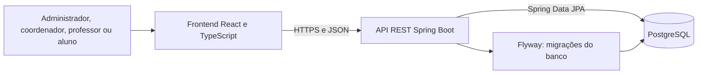

# Sistema Acadêmico — Universidade Anhanguera

Sistema web para administrar a estrutura acadêmica e consultar cronogramas de aulas. O projeto separa a interface, a API e o banco de dados: o navegador acessa uma aplicação React, que consome uma API REST em Spring Boot; a API valida as permissões e persiste os dados no PostgreSQL.

## Visão geral



O administrador mantém cursos, matérias, coordenadores, professores e salas. O coordenador prepara, edita e publica aulas nos cursos sob sua responsabilidade. O professor consulta suas aulas e pode atualizar a sala ou a situação delas. O aluno consulta sem conta, escolhendo curso, semestre e período.

A autorização é aplicada pela API. O frontend não guarda as senhas e mantém o token de acesso em memória. Os dados acadêmicos ficam no PostgreSQL, não no armazenamento local do navegador.

## Funcionalidades

- **Administração:** cadastro e edição de cursos, matérias, coordenadores, professores e salas; consulta de vínculos; importação de arquivos JSON com prévia.
- **Cronograma:** cadastro de aulas únicas ou semanais, validação de conflitos, edição individual ou da série e publicação para as turmas.
- **Professor:** consulta por curso, semestre e período; visualização semanal ou compacta do semestre; atualização da sala e do estado da aula.
- **Aluno:** consulta anônima por curso, semestre e período; visualização da semana atual ou de um mês; notificações semanais.
- **Salas:** o banco cria salas padrão na primeira aplicação das migrações: 101–119, 201–219, 301–319, 401–419 e Lab1–Lab6.

## Tecnologias

| Camada | Tecnologias |
| --- | --- |
| Interface | React, TypeScript, Vite e Tailwind CSS |
| API | Java 17, Spring Boot, Spring Security e Spring Data JPA |
| Banco | PostgreSQL e Flyway |
| Testes | Vitest, React Testing Library, Playwright e testes de integração da API |

O Node.js e o npm são usados para instalar dependências, executar as ferramentas do frontend, gerar o build e rodar os testes. Em produção, o navegador recebe os arquivos estáticos compilados; a API continua rodando em Java.

## Executar localmente

### Requisitos

- Git.
- Java 17.
- Node.js 22.22 ou compatível e npm.
- Docker Desktop com Docker Compose, ou um PostgreSQL disponível.
- PowerShell para usar os scripts `.ps1` apresentados abaixo.

### 1. Preparar e iniciar o PostgreSQL e a API

Clone o repositório e entre na pasta do projeto. Na primeira execução, crie a configuração local:

```powershell
Copy-Item backend/.env.example backend/.env
```

Edite `backend/.env` e substitua `DB_PASSWORD` e `ADMIN_PASSWORD` por valores privados. A senha inicial do administrador deve ter pelo menos 12 caracteres. O CPF inicial é `99999999999`; se desejar outro, defina `ADMIN_CPF` antes da criação da primeira conta.

Abra um terminal na pasta `backend` e inicie o banco e a API:

```powershell
cd backend
docker compose up -d
.\run.ps1
```

O Compose disponibiliza o PostgreSQL em `localhost:5433` e mantém os dados no volume `academico_data`. A API fica em `http://localhost:8080/api`. Na inicialização, o Flyway aplica as migrações pendentes.

Para usar um PostgreSQL instalado fora do Compose, altere `DB_URL`, `DB_USER` e `DB_PASSWORD` em `backend/.env`. O padrão do Compose é `jdbc:postgresql://localhost:5433/academico`.

### 2. Iniciar o frontend

Abra outro terminal na raiz do projeto:

```powershell
cd frontend
npm ci
npm run dev
```

Acesse **http://127.0.0.1:5173**. Durante o desenvolvimento, o Vite encaminha as requisições `/api` para a API local na porta 8080. Se a API usar outra porta, defina `API_PROXY_TARGET` antes de iniciar o Vite.

### 3. Primeiro acesso

Use o CPF e a senha definidos em `ADMIN_CPF` e `ADMIN_PASSWORD` para entrar como administrador. A senha do ambiente só cria a conta inicial quando ainda não existe um administrador; alterá-la depois não redefine a senha já gravada.

Cadastre os cursos e matérias, vincule professores e coordenadores e então crie aulas pela conta do coordenador. Alunos acessam pelo botão **Entrar como aluno**, sem CPF ou senha.

### Acessar o banco com pgAdmin

Para uma instalação local via Compose, registre um servidor no pgAdmin com estes dados:

| Campo | Valor |
| --- | --- |
| Host | `localhost` |
| Porta | `5433` |
| Banco | `academico` |
| Usuário | `academico` |
| Senha | valor de `DB_PASSWORD` em `backend/.env` |

Mantenha o volume `academico_data` para preservar os dados. Evite remover o volume ao desligar o Compose.

## Deploy

A implantação atual usa **Supabase para PostgreSQL**, **Render para a API** e **Cloudflare Pages para o frontend**. A publicação do frontend e da API não inclui migração de dados existentes: os dados ficam no banco Supabase configurado para o serviço.

### 1. Banco PostgreSQL no Supabase

Crie ou selecione um projeto no Supabase. No painel **Connect**, copie as credenciais do **Session pooler** e use os valores fornecidos pelo painel para configurar o serviço Render. O Supabase recomenda o pooler de sessão como alternativa quando o ambiente não consegue usar a conexão direta; escolha host, porta e usuário apresentados no painel, sem tentar montá-los manualmente.

Configure no Render:

```text
DB_URL=jdbc:postgresql://<HOST_DO_POOLER>:<PORTA>/<BANCO>?sslmode=require
DB_USER=<USUARIO_DO_POOLER>
DB_PASSWORD=<SENHA_DO_BANCO>
```

Mantenha `DB_PASSWORD` como variável secreta. A senha não deve ser incluída na URL se estiver configurando `DB_USER` e `DB_PASSWORD` separadamente. Faça backup do banco de forma independente do GitHub e dos deploys.

### 2. API no Render

Crie um **Web Service** conectado ao repositório e à branch `main`, usando Docker. Como o Dockerfile copia arquivos a partir da raiz do monorepo, mantenha a raiz do serviço como a raiz do repositório e informe o caminho `backend/Dockerfile` como Dockerfile.

Configure as variáveis de ambiente do serviço:

| Variável | Valor |
| --- | --- |
| `DB_URL` | URL JDBC do PostgreSQL Supabase conforme acima |
| `DB_USER` | Usuário fornecido pelo Session pooler |
| `DB_PASSWORD` | Senha do banco, armazenada como segredo |
| `ADMIN_CPF` | CPF inicial do administrador, somente para a primeira criação |
| `ADMIN_PASSWORD` | Senha inicial forte, com pelo menos 12 caracteres |
| `CORS_ORIGINS` | `https://projeto-integrado-ii-iii.pages.dev` |
| `SEMESTER_START` | Data inicial ISO, por exemplo `2026-08-03` |
| `SEMESTER_END` | Data final ISO, por exemplo `2026-12-18` |

O Render fornece a porta HTTP em `PORT`; não fixe uma porta diferente nas configurações do serviço. No primeiro deploy, o Flyway cria ou atualiza o esquema do banco.

### 3. Frontend no Cloudflare Pages

Crie um projeto Pages conectado ao mesmo repositório, com estas configurações:

| Configuração | Valor |
| --- | --- |
| Branch de produção | `main` |
| Diretório raiz | `frontend` |
| Preset | React (Vite) |
| Comando de build | `npm run build` |
| Diretório de saída | `dist` |
| Variável de build `VITE_API_URL` | `https://projeto-integrado-ii-iii.onrender.com/api` |

`VITE_API_URL` é incorporada nos arquivos públicos do frontend; ela deve conter somente o endereço da API, nunca credenciais ou segredos. O código também usa o endereço atual do Render como padrão de produção quando a variável está vazia ou definida como `/api`.

Após salvar as configurações, faça o deploy e confirme que ele terminou com sucesso. Um push para `main` inicia novos builds quando a integração Git do Pages está habilitada. A API aceita apenas as origens listadas em `CORS_ORIGINS`; se mudar o domínio do frontend, atualize essa variável no Render e faça novo deploy.

### Endereços atuais

- Frontend: [projeto-integrado-ii-iii.pages.dev](https://projeto-integrado-ii-iii.pages.dev)
- API: [projeto-integrado-ii-iii.onrender.com](https://projeto-integrado-ii-iii.onrender.com)

Os nomes dos serviços e os domínios podem mudar. Se forem alterados, atualize `VITE_API_URL` no Cloudflare Pages e `CORS_ORIGINS` no Render.

### Documentação oficial dos provedores

- [Cloudflare Pages: configuração de build](https://developers.cloudflare.com/pages/configuration/build-configuration/)
- [Render: deploy com Docker](https://render.com/docs/docker) e [variáveis de ambiente](https://render.com/docs/configure-environment-variables)
- [Supabase: conexão com PostgreSQL](https://supabase.com/docs/guides/database/connecting-to-postgres)

## Testes e build

Os testes de integração da API e os testes de navegador criam registros. Execute-os somente contra um banco PostgreSQL isolado, com nome terminado em `_test`; nunca use o banco de produção.

Frontend:

```powershell
cd frontend
npm test
npm run build
npm run test:e2e
```

Backend:

```powershell
cd backend
.\mvnw.cmd test
.\mvnw.cmd -DskipTests package
```

Consulte [docs/TESTES.md](docs/TESTES.md) antes de executar testes que usam a API e o PostgreSQL. Para validar apenas a compilação do frontend, `npm run build` gera o site em `frontend/dist`.

## Dados e segurança

- Não envie `backend/.env`, backups, senhas, tokens ou dados pessoais ao repositório.
- Não use variáveis `VITE_*` para segredos: elas são incluídas no frontend compilado.
- A conta inicial do administrador é criada somente quando o banco ainda não possui uma conta de administrador.
- O login retorna um token Bearer com validade definida pelo backend; a sessão atual fica em memória no navegador.
- Arquivos de backup não são transferidos automaticamente para o PostgreSQL. Quando necessário, use a importação disponível na área administrativa.
- O volume Docker local e o serviço Supabase são armazenamentos diferentes. Um backup de um ambiente não atualiza o outro.

## Estrutura do repositório

```text
frontend/   React, TypeScript, telas, componentes e testes
backend/    API Spring Boot, módulos JPA, migrações Flyway e Dockerfile
docs/       Arquitetura, fluxogramas e procedimentos de teste
```

## Documentação adicional

- [Arquitetura](docs/ARQUITETURA.md)
- [Fluxogramas](docs/FLUXOGRAMAS.md)
- [Testes](docs/TESTES.md)
- [API, endpoints e configuração](backend/README.md)
