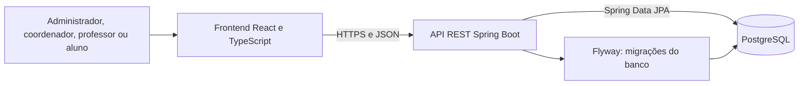

# Sistema Acadêmico — Universidade Anhanguera

> Sistema web para administrar a estrutura acadêmica e consultar cronogramas de aulas.
> 

**Demo online:** https://projeto-integrado-ii-iii.pages.dev

> **Aviso:** a API roda em plano gratuito. Se ficar um tempo sem uso,
o primeiro acesso pode levar cerca de 1 minuto. Aguarde e recarregue a página.
> 

## Sumário

- Contexto acadêmico
- Sobre o projeto
- Perfis e funcionalidades
- Arquitetura
- Tecnologias
- Screenshots
- Executar localmente
- Deploy
- Testes
- Segurança e dados
- Estrutura do repositório
- Equipe
- Licença

## Contexto acadêmico

| Item | Informação |
| --- | --- |
| Instituição | Universidade Anhanguera |
| Curso | Analise e Desenvolvimento de Sistemas  |
| Disciplina | Projeto Integrado II e III |
| Professor(a) | Nicolas Vogiantzis |
| Semestre | 2.º - 3.º |

## Sobre o projeto

**Problema:** Frequentemente problemas com localização de qual sala será a aula.

**Solução:** uma aplicação web em que o administrador mantém a estrutura
acadêmica, o coordenador publica as aulas, o professor acompanha as suas e
o aluno consulta o cronograma sem precisar de conta.

**Público-alvo:** administradores, coordenadores, professores e alunos
da instituição.

## Perfis e funcionalidades

| Perfil | O que faz |
| --- | --- |
| Administrador | Cadastra e edita cursos, matérias, coordenadores, professores e salas; consulta vínculos; |
| Coordenador | Cria aulas únicas ou semanais, com validação de conflitos; edita uma aula ou a série; publica para as turmas |
| Professor | Consulta aulas por curso, semestre e período (visão semanal ou compacta); atualiza sala e situação da aula |
| Aluno | Consulta sem login por curso, semestre e período; vê a semana atual ou um mês; recebe notificações semanais |

O banco cria salas padrão na primeira migração: 101–119, 201–219, 301–319,
401–419 e Lab1–Lab6.

## Arquitetura



A autorização é feita pela API. O frontend não guarda senhas e mantém o
token de acesso apenas em memória.

## Tecnologias

| Camada | Tecnologias |
| --- | --- |
| Interface | React, TypeScript, Vite e Tailwind CSS |
| API | Java 17, Spring Boot, Spring Security e Spring Data JPA |
| Banco | PostgreSQL e Flyway |
| Testes | Vitest, React Testing Library, Playwright e testes de integração |

## Screenshots

Tela de Login


Painel do Admin


Painel do coordenador


Cronograma do Professor


Cronograma do Aluno


## Executar localmente

### Requisitos

- Git
- Java 17
- Node.js 22.22 (ou compatível) e npm
- Docker Desktop com Docker Compose (ou um PostgreSQL próprio)

### 1. Banco de dados e API

```Terminal
# Clone e entre na pasta do projeto
git clone <https://github.com/frodsantana/projeto-integrado-II-III.git>
cd projeto-integrado-II-III

# Cria a configuração local a partir do modelo
Copy-Item backend/.env.example backend/.env
```

Edite `backend/.env` e troque `DB_PASSWORD` e `ADMIN_PASSWORD` por valores
privados (a senha do admin precisa ter **12 caracteres ou mais**).

```Terminal
cd backend
docker compose up -d   # sobe o PostgreSQL em localhost:5433
.\run.ps1              # sobe a API em <http://localhost:8080/api>
```

O Flyway aplica as migrações automaticamente na inicialização.

### 2. Frontend

Em **outro terminal**:

```Terminal
cd frontend
npm ci
npm run dev
```

Acesse **http://127.0.0.1:5173**. Em desenvolvimento, o Vite encaminha
`/api` para a porta 8080. Se a API usar outra porta, defina
`API_PROXY_TARGET` antes de iniciar.

### 3. Primeiro acesso

Entre como administrador com o `ADMIN_CPF` (padrão: `99999999999`) e a
`ADMIN_PASSWORD` do seu `.env`. Depois:

1. Cadastre cursos e matérias
2. Vincule professores e coordenadores
3. Crie aulas pela conta do coordenador
4. Alunos entram por **Entrar como aluno**, sem CPF ou senha

<details>
<summary>Acessar o banco com o pgAdmin</summary>

| Campo | Valor |
| --- | --- |
| Host | `localhost` |
| Porta | `5433` |
| Banco | `academico` |
| Usuário | `academico` |
| Senha | valor de `DB_PASSWORD` em `backend/.env` |

</details>

## Deploy

| Parte | Serviço | Endereço |
| --- | --- | --- |
| Frontend | Cloudflare Pages | https://projeto-integrado-ii-iii.pages.dev |
| API | Render (Docker) | https://projeto-integrado-ii-iii.onrender.com |
| Banco | Supabase (PostgreSQL) | — |

Variáveis de ambiente (apenas os nomes; os valores ficam nos painéis):

| Onde | Variáveis |
| --- | --- |
| Render (API) | `DB_URL`, `DB_USER`, `DB_PASSWORD`, `ADMIN_CPF`, `ADMIN_PASSWORD`, `CORS_ORIGINS`, `SEMESTER_START`, `SEMESTER_END` |
| Cloudflare Pages | `VITE_API_URL` |

## Testes

> Os testes criam registros. Rode **somente** em um banco isolado, com nome
terminado em `_test`. Nunca use o banco de produção.
> 

```bash
# Frontend
cd frontend
npm test
npm run test:e2e

# Backend
cd backend
.\mvnw.cmd test
```

Mais detalhes em docs/TESTES.md.

## Segurança e dados

- Nunca envie `backend/.env`, backups, senhas ou tokens ao repositório
- Variáveis `VITE_*` vão para o frontend compilado: não coloque segredos nelas
- A conta inicial do admin só é criada se ainda não existir um administrador

## Estrutura do repositório

```
frontend/   React, TypeScript, telas, componentes e testes
backend/    API Spring Boot, módulos JPA, migrações Flyway e Dockerfile
docs/       Arquitetura, fluxogramas e procedimentos de teste
```

Documentação adicional: Arquitetura ·
Fluxogramas · Testes ·
API e endpoints

## Equipe

| Nome | GitHub | Responsabilidade |
| --- | --- | --- |
| Felipe Rodrigues de Santana | @frodsantana | Desenvolvedor Backend |
|  |  |  |
|  |  |  |
|  |  |  |

## Licença

Projeto acadêmico, todos os direitos reservados.
